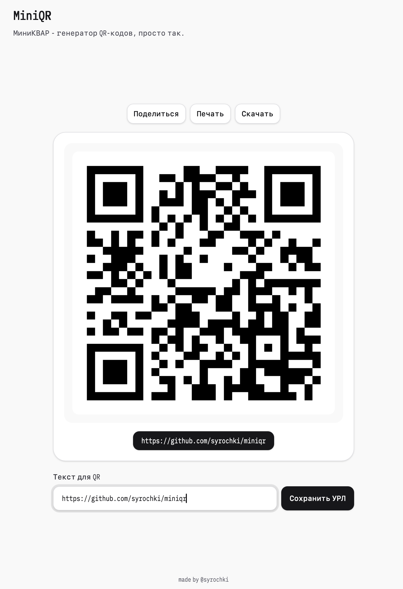

# MiniQR

Минимальный генератор QR‑кодов (текст/ссылка) на **Nuxt** + **Tailwind CSS** + **TypeScript**.



## Реализовано

- Большой QR по центру страницы
- Кнопки: Поделиться / Печать / Скачать (PNG)
- Состояние хранится в URL через `?s=...`

## Установка Bun

- <a href="https://bun.sh">Bun.js</a>

## Локальный запуск

```bash
bun install
bun run dev
```

## Статическая сборка

```bash
bun run generate
```

Результат сборки появляется в `.output/public`.

made by @syrochki
